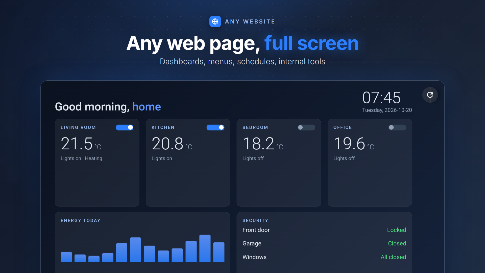
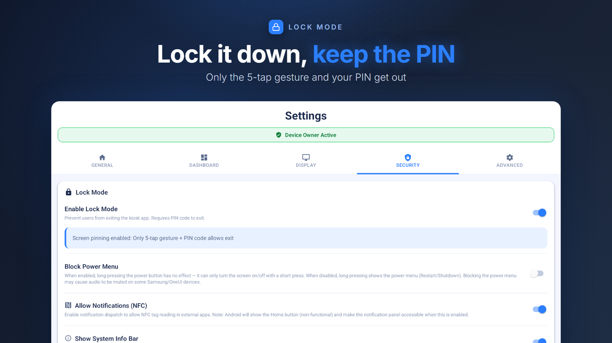

<div align="center">
  <h1>FreeKiosk</h1>
  <p><strong>Free open-source kiosk mode for Android tablets</strong></p>
  <p>Alternative to Fully Kiosk Browser (<a href="https://freekiosk.app/vs-fully-kiosk/">see how they compare</a>)</p>
  
  <p>
    <a href="https://freekiosk.app">Website</a> •
    <a href="#-install-in-60-seconds">Installation</a> •
    <a href="docs/faq.md">FAQ</a> •
    <a href="#-key-capabilities">Features</a>
  </p>
  
  <p>
    
    <a href="https://github.com/rushb-fr/freekiosk/releases"></a>
    
    
    
    
    
  </p>
  
  <p><strong>A <a href="https://rushb.fr">Rushb</a> Project</strong></p>
</div>

FreeKiosk is an open-source kiosk platform for Android tablets, built for teams that want **full control without license costs**.

<p align="center">
  <a href="https://play.google.com/store/apps/details?id=com.freekiosk"></a>
  <a href="https://github.com/rushb-fr/freekiosk/releases/latest"></a>
</p>

<p align="center">
  
  
</p>

Instead of burying everything in one long page, this README gives you the essentials and points to complete docs in `docs/`.

### Why teams choose it

- ✅ Free and MIT licensed
- ✅ Device Owner support for true lockdown
- ✅ Works in WebView mode or External App mode
- ✅ Native REST API and MQTT integration
- ✅ Headless ADB provisioning for mass rollout
- ✅ Privacy-first: no mandatory tracking layer
- ✅ Available in English, French and Brazilian Portuguese

## ✨ Key capabilities

| Area | What you get | Deep dive |
|---|---|---|
| Kiosk modes | Website (WebView), External App, Dashboard of pages, Media Player (videos and images) | [Features and Modes](docs/features-and-modes.md) |
| Device control | Lock task, boot behavior, status bar policies, PIN access | [Installation](docs/installation.md) |
| Automation | 40+ REST endpoints, MQTT discovery for Home Assistant | [Integrations](docs/INTEGRATIONS.md) |
| Provisioning | ADB command-based configuration and scripting | [ADB Configuration](docs/adb-configuration.md) |
| Fleet management | Optional FreeKiosk Cloud (open beta): remote config, commands, screenshots, QR enrollment | See [FreeKiosk Cloud](#-freekiosk-cloud-open-beta) below |

## 📦 Install in 60 seconds

1. Install FreeKiosk from [Google Play](https://play.google.com/store/apps/details?id=com.freekiosk), or download the latest APK from [Releases](https://github.com/rushb-fr/freekiosk/releases).
2. Install on Android 8.0+ tablet.
3. Configure URL/app + PIN.
4. Start kiosk mode.

For production lockdown, use Device Owner mode:

```bash
adb shell dpm set-device-owner com.freekiosk/.DeviceAdminReceiver
```

👉 Full setup guide: [docs/installation.md](docs/installation.md)

## 🧩 Docs map

| I want to... | Go to |
|---|---|
| Deploy tablets correctly | [Installation Guide](docs/installation.md) |
| Understand display/kiosk modes | [Features and Modes](docs/features-and-modes.md) |
| Integrate with Home Assistant | [Integrations Overview](docs/INTEGRATIONS.md) |
| Use API endpoints | [REST API Docs](docs/rest-api.md) |
| Configure MQTT topics/discovery | [MQTT Docs](docs/MQTT.md) |
| Provision with scripts | [ADB Configuration](docs/adb-configuration.md) |
| Follow release direction | [Roadmap and Changelog](docs/roadmap-and-changelog.md) |
| Contribute code | [Development Guide](docs/development.md) |

## ☁️ FreeKiosk Cloud (open beta)

**FreeKiosk Cloud** is a companion service that manages a fleet from a web dashboard: live status, configuration pushed to devices or groups, remote commands and screenshots. A tablet can be enrolled by scanning a QR code, and a factory-reset tablet can be provisioned end to end from the Android setup wizard.

**The cloud is in open beta, with self-service sign-up** at [cloud.freekiosk.app](https://cloud.freekiosk.app): the first device is free, then it is priced per device (see [freekiosk.app/cloud](https://freekiosk.app/cloud)). The app itself, `v2.0.0`, is stable. Some cloud paths (over-the-air app updates, QR provisioning, Lock Mode behaviour on every model) have not been proven across enough real hardware for us to call the cloud finished.

**The app itself is unaffected.** FreeKiosk stays free and MIT licensed, and the cloud is entirely opt-in: nothing leaves the device until you enroll it. Every kiosk feature, the REST API and the MQTT integration work exactly as before without a cloud account, and always will.

> [!NOTE]
> **The management server will be released as open source in 2027, so you can self-host it.**
> That is the intended end state, not an afterthought: a kiosk platform you cannot host yourself is only half free. We are holding it back until it is stable and feature-complete rather than publishing something that would be painful to run.

## 🛠️ Tech stack

- React Native + TypeScript
- Kotlin native modules (Android policy and system control)
- Android SDK 26+ (Android 8+)

## 🗺️ Roadmap snapshot

- `v1.2.x`: reliability and operational hardening (shipped)
- `v2.0.0`: stable app, with optional cloud enrollment (shipped)
- FreeKiosk Cloud: open beta, until the OTA update path, QR provisioning and Lock Mode behaviour are proven on real fleets
- 2027: the management server released as open source for self-hosting

Detailed notes: [docs/roadmap-and-changelog.md](docs/roadmap-and-changelog.md)

## 🤝 Contributing

Contributions are welcome.

- Guidelines: [CONTRIBUTING.md](CONTRIBUTING.md)
- Issues: [GitHub Issues](https://github.com/rushb-fr/freekiosk/issues)
- Discussions: [GitHub Discussions](https://github.com/rushb-fr/freekiosk/discussions)

---

## 📄 License

MIT License. See [LICENSE](LICENSE).

<div align="center">
  
  
  
  
</div>

<div align="center">
  <p><strong>Made with ❤️ in France by Rushb</strong></p>
  <p>
    <a href="https://freekiosk.app">Website</a> •
    <a href="https://github.com/rushb-fr/freekiosk">GitHub</a> •
    <a href="mailto:support@freekiosk.app">Contact</a>
  </p>
</div>